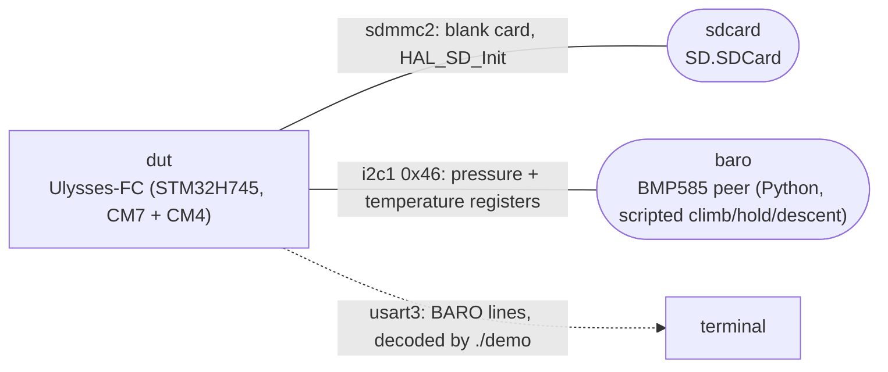

# Ulysses

Firmware for UBC Rocket's experimental VTOL platform.

> **This fork:** [`sim/`](sim/README.md) runs both cores of this firmware on a simulated STM32H745 and checks
> a barometer driver against a scripted peer, no hardware needed.

## Demo


The real BMP585 driver (`dev/ivan/baro`) runs on the CM7 of a simulated STM32H745 and samples a scripted barometer
every 20 ms; `./demo` prints what the firmware sent on USART3 as hPa and degC. Pressure and temperature are
**stand-ins**: `sim/peers/bmp585.py` plays a scripted climb to 300 m, hold, and descent (the stimulus, not a flight),
and the driver's job is to decode it. The `alt` column is not printed by the firmware; `./demo` computes it from the
driver's pressure with the ISA formula.



Run it (needs `sim` on PATH, `curl -fsSL https://simantic.com/install | sh`; the firmware images are committed in `sim/fw`):

```
./demo     # about 90 s wall for 2.2 virtual s
sim/run.sh # PASS or FAIL checks
```

