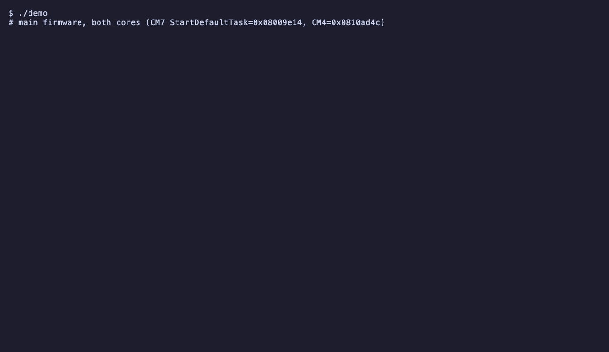
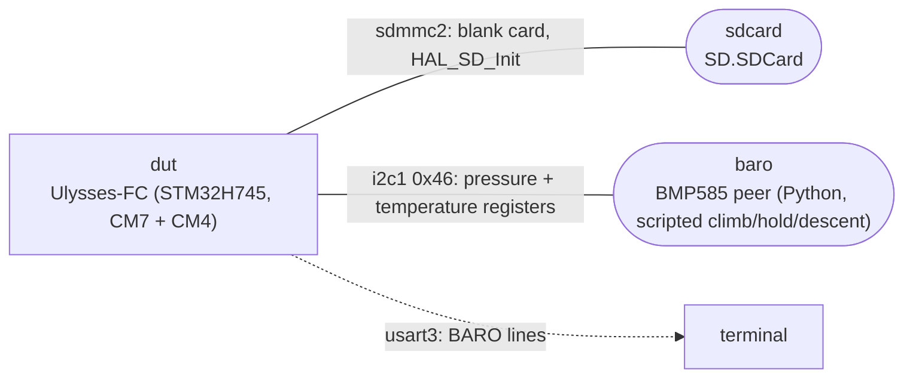

# Ulysses

Firmware for UBC Rocket's experimental VTOL platform.

> **This fork:** [`sim/`](sim/README.md) runs both cores of this firmware on a simulated STM32H745 and checks
> a barometer driver against a scripted peer, no hardware needed.

## Demo



`./demo` streams what the firmware side really emits, live. The Ulysses firmware on `main` prints nothing (no console),
so part 1 shows the simulator's own evidence: `--trace-symbol` hits on each core's `StartDefaultTask` (CM7 at 1.78 ms, CM4
at 10.07 ms; the `Error_Handler`, `HardFault_Handler` and assert addresses are traced too and never hit) and the first
interrupt-trace lines. Part 2 runs the `dev/ivan/baro` build, whose real BMP585 driver the CM7 samples every 20 ms and
prints on USART3: those `BARO` lines are shown verbatim, and the `=> hPa / C` suffix is added by `./demo`. This is the only
log channel the firmware has. Pressure and temperature are **stand-ins**: `sim/peers/bmp585.py` plays a scripted climb to
300 m, hold, and descent (the stimulus, not a flight).



Run it (needs `sim` on PATH, `curl -fsSL https://simantic.com/install | sh`; the firmware images are committed in `sim/fw`):

```
./demo     # about 100 s wall: 0.3 s boot trace + 2.2 virtual s of barometer
sim/run.sh # PASS or FAIL checks
```

