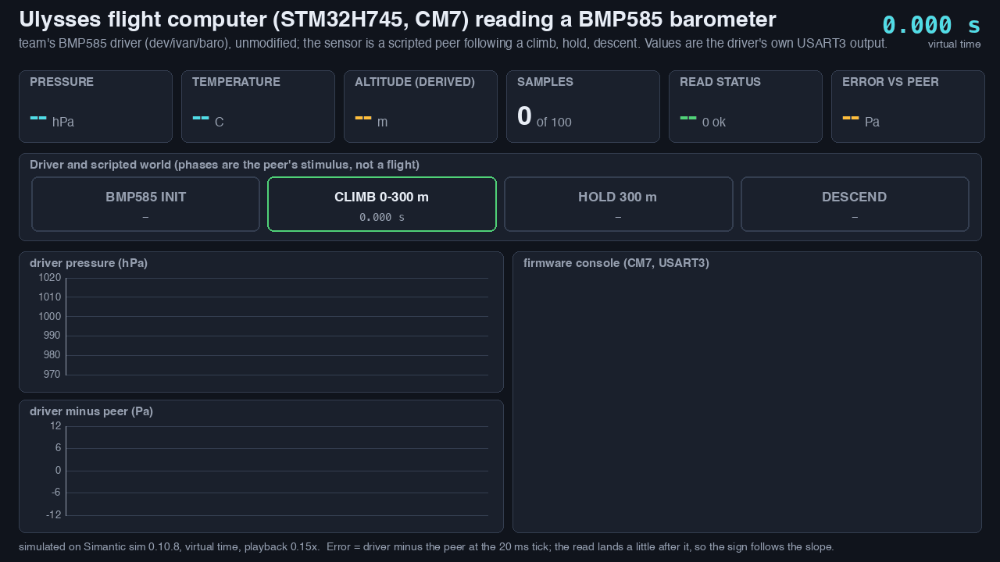
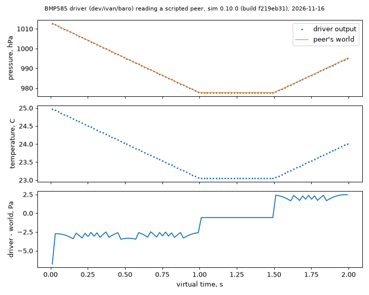
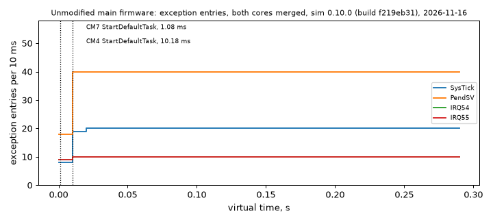
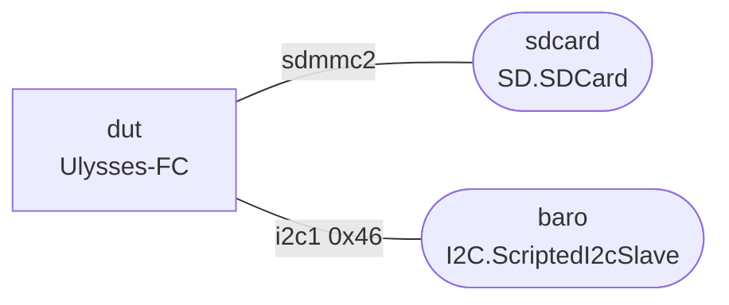

# Ulysses in a simulator

UBC Rocket's Ulysses firmware (STM32H745, Cortex-M7 + Cortex-M4, CubeMX + HAL + FreeRTOS) running both
cores on a simulated `Ulysses-FC` (STM32H745ZI, 24 MHz HSE, blank SD card on SDMMC2), no board needed.
Backend: Simantic's `sim` 0.10.0 (build f219eb31), the released binary, on the **pyrite** engine
(Rust, in-process, JIT on by default). Everything below was run on 2026-11-16.



*Animation of config 2 re-run on `sim` 0.10.8 (build 64f89c38), 2026-11-25: the 100 samples the CM7 driver printed on USART3, drawn in the order they arrive, against the peer's scripted pressure. Virtual time (2.2 s); the run took 49 s of wall time on a loaded laptop, about 22 s per virtual second. Pressure error vs the peer 8.8 Pa max, temperature 5.6 mC max. Redraw: `sim/make_gif.py sim/out/baro.txt sim/screenshots/ulysses-baro.gif "sim 0.10.8"` (matplotlib, pillow).*



*Config 2, 2.0 s of virtual time: the real BMP585 driver (`dev/ivan/baro`) sampled every 20 ms by the CM7 and
printed on USART3, against `peers/bmp585.py` whose pressure and temperature follow a scripted climb, hold and
descent (the stimulus, not a flight). Bottom panel: the driver's pressure minus the peer's value at the tick time;
within 7 Pa, and the sign of the offset follows the slope of the profile (the read lands a little after the tick). `sim` 0.10.0
(f219eb31).*



*Config 1, 0.3 s of virtual time, unmodified main-branch firmware: exception entries per 10 ms from `--trace-interrupts`
(both cores merged; IRQ54 and IRQ55 are the two cores' HAL tick timers and coincide). The CM7 reaches
`StartDefaultTask` at 1.08 ms and the CM4 at 10.18 ms. `sim` 0.10.0 (f219eb31).*

## What runs

| Part | Model | Bus |
| --- | --- | --- |
| Flight controller | this tree, Debug build, both cores, CM7 in flash bank 1, CM4 in bank 2 | STM32H745ZI (`Ulysses-FC`) |
| Barometer (config 2 only) | BMP585, `peers/bmp585.py`, written from the driver, not checked on a part | I2C1 0x46 |
| SD card | the board model's blank card (HAL_SD_Init on the CM4 must succeed) | SDMMC2 |

The firmware on `main` has an I2C transport and `io_board_init()` and nothing that talks to a sensor, and it
prints nothing. So config 1 is checked by address (`--trace-symbol`; by name finds nothing with two images)
and config 2 uses a driver branch plus a small harness patch. Radio, IMU, magnetometer, LiDAR, fuel gauge and BMS
are not attached: no firmware here reads them.

`sim graph --scenario sim/scenario.yaml`:



## Configurations tried

All on `sim` 0.10.0 (f219eb31), pyrite, 2026-11-16.

| # | Configuration | Virtual s | Wall s | Result |
| --- | --- | --- | --- | --- |
| 1 | `main` unmodified, JIT, `scenario-boot.yaml` | 0.3 | 3.8 | PASS: CM7 `StartDefaultTask` at 0.001085 s, CM4 at 0.010175 s; `Error_Handler`, `HardFault_Handler` and `ulysses_assert_handler` of both cores never hit; 4730 exception enter and exit records |
| 1b | same, `--no-jit` | 0.3 | 6.5 | same two timestamps; fault handlers not traced in this run |
| 2 | `dev/ivan/baro` (2c407b5) + `patch_baro.py`, JIT, `scenario.yaml` | 2.2 | 35 | PASS: `init=0`, 100 of 100 reads return 0, pressure within 6.8 Pa and temperature within 3.6 mC of the peer's value; last line `BARO done` at about 2.01 s |

Not run: the magnetometer driver (its pinned commit is not in this fork), SPI/UART/CAN/radio paths, anything
on silicon, a run without the SD card. These are `unverified`. Speed: about 16 s of wall time per virtual
second on JIT (two cores) on this machine.

Running directly with `sim Ulysses-FC run --elf ...` prints `warning: Ulysses-FC's model is incomplete`; the
output of the runs above was not checked for the same line under `--scenario`.

## Run it

Needs `sim` on PATH, the Arm GNU toolchain, `cmake`, `ninja`, `git`; `matplotlib` for the charts.

```
sim/build.sh          # sim/build/main.hex and sim/build/baro.hex (needs the origin/dev/ivan/baro ref)
sim/run.sh            # PASS or FAIL; add "charts" to redraw sim/screenshots
```

`run.sh` asserts on the application output: both StartDefaultTask addresses reached and no fault or assert
handler hit; the barometer driver initialises, every read returns 0 and the 100 samples match the peer's pressure
and temperature within 12 Pa and 60 mC.

## Changes to the firmware

Config 1: none. Config 2 (build tree only, never committed) edits `cfp/CM7/Core/Src/main.c` of the
`dev/ivan/baro` tree (`sim/patch_baro.py`): after `io_board_init()` it calls the real driver 100 times at 20 ms
and prints each sample on USART3, because the firmware has no console. The CM7 stays in that loop afterwards.

## Gaps

- The addresses in `run.sh` belong to this exact Debug build; rebuilding with another toolchain moves them.
- The peer's profile is a stimulus; it checks the driver's decoding, not any flight behaviour.
- This fork has no LICENSE file, so no licence is stated for the firmware or for the files under `sim/`.
